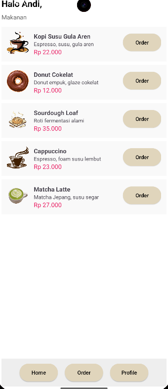
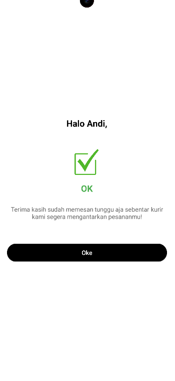

# ☕ Kopi Dan Nyemil 🥐

> *"Get a taste of your wish"* — Aplikasi pemesanan kopi dan camilan berbasis Android yang cepat, fleksibel, dan mudah digunakan!

---

## 📌 Tentang Aplikasi

**Kopi Dan Nyemil** adalah aplikasi mobile berbasis Android yang dirancang untuk mempermudah pengguna dalam menjelajahi berbagai menu kopi kekinian dan kue/camilan lezat, serta melakukan pemesanan langsung dengan pengisian alamat yang praktis. 

Dikembangkan menggunakan bahasa **Kotlin** dan **Material 3 Design System**, aplikasi ini menghadirkan antarmuka pengguna (UI) bertema *Warm Coffee & Cream* yang estetis, modern, dan responsif.

---

## ✨ Fitur Utama

- 🚪 **Splash & Welcome Screen** — Tampilan awal yang elegan untuk menyambut pengguna.
- 🔐 **Autentikasi Pengguna (Sign Up & Login)** — Akses masuk dan pendaftaran anggota baru yang cepat.
- 📜 **Katalog Menu Interaktif** — Menampilkan pilihan kopi dan makanan favorit lengkap dengan gambar, deskripsi, dan harga.
- 📍 **Pengisian Alamat Pengiriman** — Formulir pengiriman yang mudah diisi lengkap dengan patokan lokasi.
- 🎯 **Konfirmasi Pesanan Dinamis** — Layar konfirmasi pemesanan interaktif yang menyapa pengguna secara personal (`Halo <username>`).
- 👤 **Pengaturan Profil** — Memudahkan pengguna untuk melihat dan memperbarui informasi profil mereka.

---

## 📱 Tangkapan Layar (Screenshots)

| Welcome Screen | Katalog Home | Konfirmasi Pesanan |
| :---: | :---: | :---: |
|  |  |  |

---

## 🎨 Tema & Desain UI

- **Desain**: Material 3 Design
- **Palet Warna**: Warm Cream (`#E0D5BC`), Dark Charcoal Text (`#000000`)
- **Elemen UI**: Elevated Buttons dengan efek *Drop Shadow* yang lembut dan responsif.

---

## 🛠️ Teknologi & Tools

- **Bahasa Pemrograman**: Kotlin
- **Min SDK**: Android 8.1 (API Level 27)
- **Target SDK**: Android 15 (API Level 37)
- **IDE**: Android Studio
- **Arsitektur**: Multi-Activity Navigation dengan Intent Data Passing

---

## 📁 Struktur Proyek

```text
app/src/main/
├── java/lat/pam/kopidannyemil/
│   ├── MainActivity.kt          # Halaman Welcome / Onboarding
│   ├── SignUpActivity.kt        # Halaman Pilihan Sign Up / Login
│   ├── RegisterActivity.kt      # Form Registrasi Pengguna
│   ├── LoginActivity.kt         # Form Login Pengguna
│   ├── HomeActivity.kt          # Katalog Menu & Daftar Makanan/Minuman
│   ├── AlamatActivity.kt        # Form Input Alamat Pengiriman
│   ├── KonfirmasiActivity.kt    # Status & Konfirmasi Sukses Pemesanan
│   └── ProfileActivity.kt       # Pengaturan Profil Pengguna
└── res/
    ├── drawable/                # Asset Gambar (Kopi, Donut, Sourdough, Matcha, Check, DLL)
    ├── layout/                  # Tata Letak XML Antarmuka (Material 3)
    └── values/                  # Warna, Tema, & String (Kopi & Cream Theme)
```

---

## 🚀 Cara Menjalankan Proyek

1. **Clone Repositori**:
   ```bash
   git clone https://github.com/USERNAME/KopiDanNyemil.git
   ```
2. **Buka Proyek**:
   - Buka **Android Studio**.
   - Pilih **File > Open**, lalu arahkan ke folder proyek ini.
3. **Sync Gradle**:
   - Tunggu hingga proses *Gradle Sync* selesai.
4. **Jalankan Aplikasi**:
   - Hubungkan perangkat Android fisik atau jalankan Android Virtual Device (AVD / Emulator).
   - Klik tombol **Run** (`Shift + F10`) di Android Studio.

---

## 📝 Lisensi

Dipublikasikan di bawah lisensi [MIT License](LICENSE).
